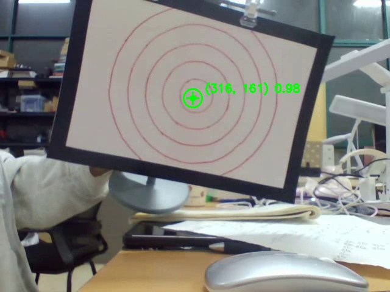
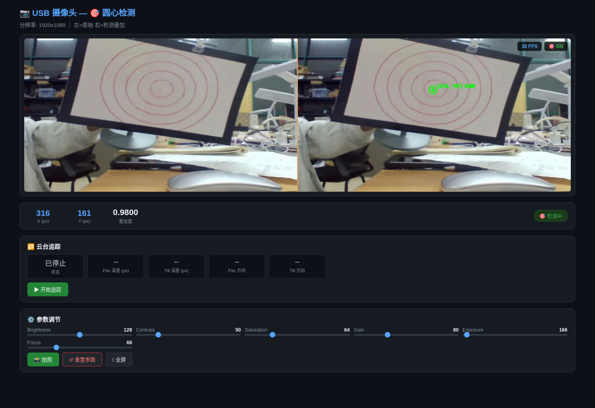

# A733 Gimbal — NPU 视觉追踪云台

**中文** — 基于 Allwinner A733 NPU 的圆心检测，驱动两台 MKS SERVO42C 闭环步进电机组成的
两轴云台，将目标自动保持在画面中心；配套 Flask 网页端提供 MJPEG 实时推流、摄像头参数
调节与云台启停控制。

**English** — A vision-tracking gimbal built on the Allwinner A733 NPU. A custom
circle-center detection model drives two MKS SERVO42C closed-loop steppers (pan/tilt)
to keep the target centered, with a Flask web UI for live MJPEG streaming, camera
tuning, and gimbal start/stop control.



> 同心圆靶的圆心检测示例（置信度 0.98）。Example of circle-center detection on a concentric-circle target (score 0.98).

## 系统架构 / Architecture

```
        USB UVC Camera (1920×1080 MJPEG)
                 │
                 │  V4L2 抓帧直通 / V4L2 passthrough capture
                 ▼
        web-camera (Flask)
        ├── MJPEG 推流 ──────────► 浏览器 / Browser（实时画面、参数面板、云台按钮）
        └── 原始帧 / raw frame
                 ▼
        npu-a733-python-engine · PointDetector（best_uint8_a733.nb）
                 │  圆心坐标 + 置信度 / center point (x, y) + score
                 ▼
        gimbal.GimbalTracker — 比例步长位置控制 / proportional-step position control
                 ▼
        MKS42C 步进电机 ×2（Pan 0xE0 / Tilt 0xE1）—— /dev/ttyAS8 @115200
```

数据流：摄像头画面 → NPU 检测圆心 → 计算圆心与画面中心的像素误差 → 电机按误差比例走步 → 目标居中。

Data flow: camera frame → NPU detects the circle center → pixel error against the frame
center is computed → motors step proportionally to the error → target stays centered.

## 网页界面 / Web Interface



**中文** — 网页端提供实时画面（检测开启时为「左：原始 | 右：检测叠加」）、圆心坐标与置信度、
云台状态与启停控制、摄像头参数调节。上图检测画面为同心圆靶的检测结果示例。

**English** — The web UI provides the live stream (raw | detection overlay when detection
is on), the detected center point and score, gimbal status with start/stop control, and
camera parameter sliders. The video area above shows an example detection result on a
concentric-circle target.

## 硬件要求 / Hardware

| 项目 / Item | 说明 / Description |
|---|---|
| 主板 / Board | Radxa 板卡，Allwinner A733 SoC（VIP Lite NPU） |
| 摄像头 / Camera | USB UVC 摄像头，支持 MJPEG 输出，1920×1080 |
| 电机 / Motors | MKS SERVO42C 闭环驱动 ×2 + NEMA17 步进电机（Pan / Tilt 两轴） |
| 串口 / Serial | `/dev/ttyAS8` @ 115200 8N1，电机地址 0xE0 / 0xE1 |
| 机械 / Frame | 两轴云台结构（42C 外壳 STL 见 `doc/42C外壳STL文件/`） |

## 目录结构 / Layout

```
.
├── web-camera/                 网页端：MJPEG 推流 + 检测叠加 + 云台 API
│   ├── app.py                  Flask 入口（推流 / 拍照 / 参数 / 云台启停）
│   ├── camera.py               摄像头封装（后台线程抓帧、参数管理）
│   ├── v4l2_capture.py         V4L2 ioctl 封装（MJPEG 直通）
│   ├── detector.py             NPU 圆心检测 + 画面叠加 + 左右拼合
│   └── templates/index.html    网页控制面板
├── npu-a733-python-engine/     纯 Python 的 Allwinner NPU 推理引擎
│   ├── src/npu_engine/         ctypes 封装 VIP Lite（backend / preprocess / postprocess / estimator）
│   ├── model/                  量化模型（uint8 .nb）：圆心检测 + YOLOv8n
│   └── test_circle.py          单图推理测试脚本
├── gimbal/                     云台控制
│   ├── motor.py                MKS SERVO42C UART 协议驱动
│   ├── tracker.py              视觉追踪控制器（比例步长）
│   └── config.py               全部可调参数
├── tests/                      硬件调试脚本（摄像头 / 串口 / 电机）
└── doc/                        硬件资料（说明书、原理图、STM32 例程、外壳 STL）
```

## 快速开始 / Quick Start

要求 / Requirements：Python ≥ 3.10，A733 板卡上的 NPU 驱动（`libNBGlinker.so` 随仓库提供）。

```bash
git clone git@github.com:BoHaoZhang-CSU/a733-gimbal.git
cd a733-gimbal

python3 -m venv .venv
source .venv/bin/activate
pip install -r requirements.txt
```

启动网页端 / Start the web app：

```bash
cd web-camera
python app.py --port 5000              # 检测 + 云台追踪（默认全开）
python app.py --port 5000 --no-gimbal  # 仅圆心检测
python app.py --port 5000 --no-detect  # 纯摄像头 MJPEG 推流
```

浏览器访问 `http://<板卡IP>:5000`。Open `http://<board-ip>:5000` in a browser.

### 网页 API / Web API

| 端点 / Endpoint | 方法 / Method | 说明 / Description |
|---|---|---|
| `/video_feed` | GET | MJPEG 视频流 / MJPEG stream |
| `/api/snapshot` | POST | 拍照保存到 `snapshots/` / Save a snapshot |
| `/api/detection` | GET | 最新检测结果 + 云台状态 / Latest detection & gimbal status |
| `/api/params` | GET / POST | 读取 / 设置摄像头参数（亮度、对比度、饱和度、增益、曝光、对焦） |
| `/api/reset` | POST | 参数恢复默认 / Reset camera params |
| `/api/gimbal/start` · `/api/gimbal/stop` | POST | 启动 / 停止云台追踪 / Start or stop tracking |

## 模块说明 / Modules

### web-camera

**中文** — 后台线程从 V4L2 直接抓取原始 MJPEG 帧并直通给浏览器，跳过
「解码 → 缩放 → 再编码」环节，显著降低 CPU 占用与延迟；开启检测后改为推流
「左：原始画面 | 右：检测叠加」的拼合图。

**English** — A background thread captures raw MJPEG frames via V4L2 and passes
them straight through to the browser, skipping decode → resize → re-encode to cut
CPU usage and latency. With detection enabled, it streams a side-by-side composite
(raw | detection overlay).

### npu-a733-python-engine

**中文** — 用 ctypes 直接封装 Allwinner VIP Lite 运行时（`libNBGlinker.so`），
不依赖厂商 C++ SDK。支持 YOLO11 / YOLOv8 的检测、姿态、分割，以及本项目使用的
单点圆心检测 `PointDetector`；前后处理（letterbox、DFL 解码、NMS、坐标还原）全部为纯 Python / NumPy。

**English** — A ctypes wrapper around the Allwinner VIP Lite runtime
(`libNBGlinker.so`) with no vendor C++ SDK dependency. Supports YOLO11 / YOLOv8
detection, pose and segmentation, plus the custom single-point `PointDetector` used
here; all preprocessing / postprocessing (letterbox, DFL decode, NMS, coordinate
rescaling) is pure Python + NumPy.

```python
from npu_engine import PointDetector

det = PointDetector(model="model/best_uint8_a733.nb")
result = det(frame)          # {"point": (x, y), "score": float}
det.close()
```

### gimbal

**中文** — `motor.py` 实现 MKS SERVO42C 的 UART 协议（使能 `0xF3`、连续运转 `0xF6`、
位置控制 `0xFD`、停止 `0xF7`），多台电机共用一条串口总线、以地址区分。`tracker.py`
采用比例步长位置控制：每步脉冲数 = |像素误差| × 增益，限幅后发送一条 `0xFD` 位置
指令并等待到位，误差大走大步、误差小走小步，不会过冲震荡；置信度低于门限时不走步。

**English** — `motor.py` implements the MKS SERVO42C UART protocol (enable `0xF3`,
continuous run `0xF6`, position control `0xFD`, stop `0xF7`); multiple motors share
one serial bus and are addressed individually. `tracker.py` uses proportional-step
position control: pulses per step = |pixel error| × gain, clamped and sent as a single
`0xFD` move that completes before the next step — big error, big step; small error,
small step; no overshoot. Steps are skipped when the detection score is below threshold.

### tests

**中文** — 硬件上电排查顺序：`uart_min_test.py`（串口连通）→ `motor_test.py` /
`motor_diag.py`（电机使能、点动、诊断）→ `camera.py`（预览、调参、连拍）。

**English** — Hardware bring-up order: `uart_min_test.py` (serial link) →
`motor_test.py` / `motor_diag.py` (motor enable, jog, diagnostics) → `camera.py`
(preview, tuning, burst capture).

## 配置 / Configuration

云台参数集中在 `gimbal/config.py` / Gimbal parameters live in `gimbal/config.py`：

| 参数 / Parameter | 默认值 / Default | 说明 / Description |
|---|---|---|
| `SERIAL_PORT` | `/dev/ttyAS8` | 云台串口 / Serial port |
| `PAN_ADDR` / `TILT_ADDR` | `0xE0` / `0xE1` | 电机地址 / Motor addresses |
| `FRAME_W` / `FRAME_H` | 1920 / 1080 | 检测坐标系尺寸 / Detection frame size |
| `DEADBAND_PX` | 15 | 对准死区（像素）/ Deadband in pixels |
| `STEP_GAIN` | 0.6 | 像素误差 → 脉冲增益 / Pixel-to-pulse gain |
| `STEP_MIN` / `STEP_MAX` | 30 / 800 | 单步脉冲限幅 / Per-step pulse clamp |
| `MOVE_SPEED` | 60 | 速度档（1–127）/ Speed level |
| `STEP_TIMEOUT` | 1.5 s | 单步到位超时 / Per-step timeout |
| `MIN_SCORE` | 0.95 | 检测置信度门限 / Detection score threshold |
| `INVERT_PAN` / `INVERT_TILT` | False | 机械方向反转 / Invert axis direction |

## 已知限制 / Limitations

- **中文** — 串口设备 `ttyAS8` 与画面尺寸 1920×1080 目前为固定配置，更换板卡或摄像头需修改 `gimbal/config.py`。
- **中文** — 检测模型为针对同心圆靶训练的单点模型（`best_uint8_a733.nb`），目标类型改变需自行训练并转换模型。
- **中文** — NPU 引擎仅适用于 Allwinner A733（VIP Lite 运行时）。

- **English** — The serial device (`ttyAS8`) and frame size (1920×1080) are fixed;
  adjust `gimbal/config.py` when changing boards or cameras.
- **English** — The detection model is a single-point model trained on concentric-circle
  targets; retrain and convert your own model for other targets.
- **English** — The NPU engine targets the Allwinner A733 (VIP Lite runtime) only.

## 参考资料 / References

- MKS SERVO42C 闭环步进电机使用说明 V1.1.2（见 `doc/说明书/`，版权归 MKS 所有）
- Allwinner VIP Lite 运行时：`npu-a733-python-engine/src/npu_engine/libs/a733/`
- 厂商 STM32 例程与上位机软件见 `doc/`（版权归原作者所有，仅供学习参考）

## License

[MIT](LICENSE) © 2026 BoHaoZhang-CSU

`doc/` 目录下的厂商资料版权归 MKS 及原作者所有，不适用 MIT 许可。
Vendor materials under `doc/` remain the property of their respective owners and are
not covered by the MIT license.
